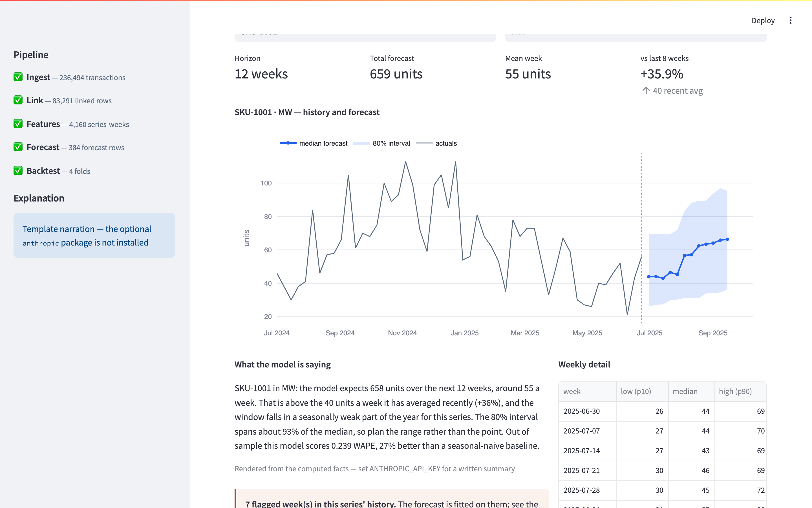
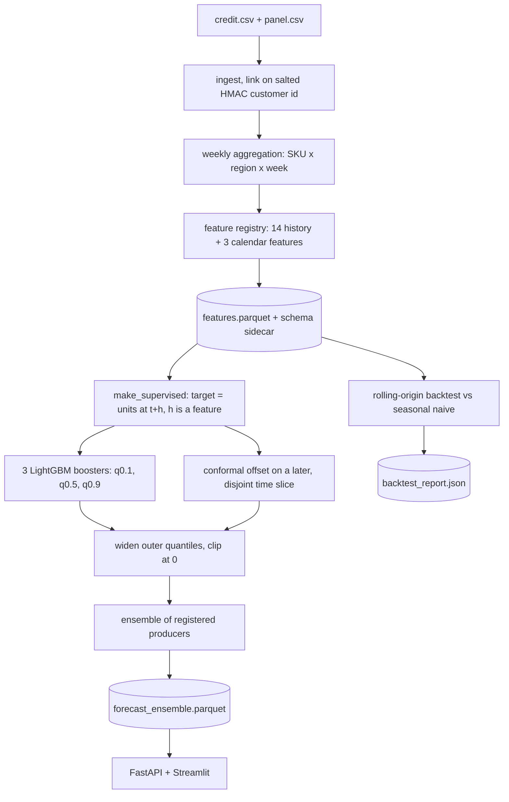
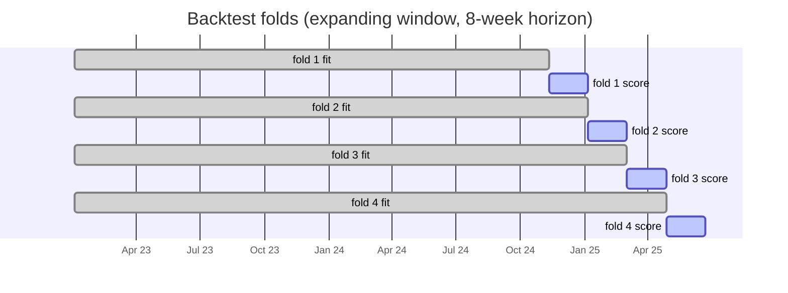
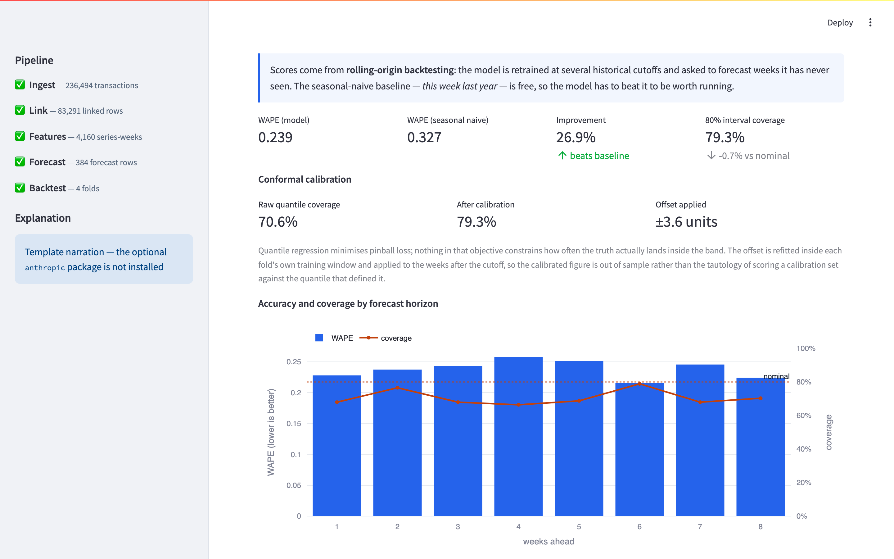

# SKU x Region Demand Forecasting

Weekly unit-demand forecasts for every SKU in every region, delivered as a calibrated 80% prediction interval
that a planner can size safety stock against. LightGBM quantile regression, conformal calibration, a rolling-origin
backtest against a seasonal-naive baseline, a FastAPI service and a Streamlit dashboard. It runs from a clean clone
with no credentials and no dataset to download.

## Results

Four rolling-origin folds, 8-week horizon, scored only on weeks after each fold's cutoff
(`python -m src.evaluation.backtest --folds 4 --horizon 8`, also written to `backtest_report.json`):

```
cutoff         rows     WAPE    naive    lift   cover     cal
--------------------------------------------------------------
2024-11-11      256    0.233    0.341  31.9%   68.8%   73.4%
2025-01-06      256    0.244    0.316  22.9%   71.9%   83.2%
2025-03-03      256    0.243    0.330  26.4%   69.9%   78.5%
2025-04-28      256    0.236    0.320  26.1%   71.9%   82.0%
--------------------------------------------------------------
mean                   0.239    0.327  26.9%   70.6%   79.3%
```

The median forecast has 26.9% lower WAPE than "same week last year". The raw 10th to 90th percentile band covered
the truth 70.6% of the time; after conformal calibration it covers 79.3% against a nominal 80%, out of sample.
LightGBM is not bit-identical across platforms, so expect the third decimal to drift on other hardware.



## Running locally

Python 3.11 (pinned pyarrow 12 has no 3.12 wheel), plus OpenMP for LightGBM: `brew install libomp` or `libgomp1`.

```bash
python3.11 -m venv .venv && source .venv/bin/activate
pip install -r requirements-core.txt -r requirements-dev.txt
python -m scripts.run_pipeline --weeks 130 --horizon 12   # generate data, ingest, link, features, train, ensemble
python -m src.evaluation.backtest --folds 4 --horizon 8   # the table above
python -m pytest tests/ -q                                # 289 tests
uvicorn src.serving.app:app --port 8000                   # API
streamlit run streamlit_demo.py                           # dashboard on :8501
```

The pipeline generates 236,494 seeded transactions (8 SKUs x 4 regions x 130 weeks) into `DATA_DIR` (default
`./data`, git-ignored). `HASH_SALT` keys the customer-id HMAC; its default is public, so set it for real data.

| Endpoint | Returns |
|---|---|
| `POST /forecast` | `q0.1`, `q0.5`, `q0.9` per week for `{"sku", "region", "horizon_weeks"}`; 404 for an unknown series |
| `POST /explain` | the forecast plus a plain-language note (template, or Claude if `anthropic` and a key are present) |
| `GET /anomalies` | flagged input weeks with a summary by kind |
| `GET /models` | registered forecasters and any orphan forecast files on disk |

## Architecture



Each fold refits the boosters and the conformal offset on everything up to its cutoff, then scores the next 8 weeks:



## Design decisions

**Features cannot see the current week.** Features are declared in `src/features/registry.py` against a `History`
object that only exposes the target and price already shifted one week. `History.lag(0)` raises, and nothing returns
the row's own week, so a leaking rolling mean is not something a new feature can express. Calendar features (week of
year, month, year) live in a separate, explicit list. The leakage tests enumerate the registry, so a feature added
later is covered automatically. Shifting the lag by one more step makes 10 tests fail. The cost is a small DSL to learn.

**Direct multi-horizon, one model per quantile.** Each training row is (origin week, horizon h, target at t+h), with
h as a feature, so a single booster per quantile covers all 12 horizons without feeding predictions back in. I chose
this over a recursive model so errors do not compound and intervals stay meaningful at long horizons. The price is a
training set 12 times the size of the feature table (47,424 rows).

**Conformal calibration on a time split.** Pinball loss says nothing about how often the truth lands in the band.
`src/evaluation/conformal.py` implements conformalised quantile regression (Romano, Patterson and Candès, 2019):
score each calibration row by how far it fell outside the band, take the `(1-α)(1 + 1/n)` quantile, widen both ends.
The calibration slice is later in time than the fit slice; a random split would put a week's neighbours on both
sides. Time series are not exchangeable, so the coverage guarantee is not assumed; it is measured in the backtest.

**Only registered models get blended.** `src/models/registry.py` lists the forecasters this code implements. A
`forecast_*.parquet` with no registered producer is logged as an orphan, shown at `GET /models` and in the dashboard,
and left out of the ensemble (`--include-unregistered` overrides). The DeepAR and PyMC trainers are stubs and are
not registered. Feature tables carry a `.schema.json` sidecar, and loading refuses a table whose columns disagree
with the compiled-in registry.

**A cached, indexed forecast store.** `src/serving/store.py` loads the forecast parquet once, indexes it by
`(sku, region)` and invalidates on the file's `(mtime_ns, size)`, so a fresh pipeline run is served on the next
request without a restart. `python -m scripts.benchmark --only serving` at 25,000 series x 12 weeks measures about
29 ms per request reading parquet each time against about 23 µs warm, with a one-off index build of about 1.2 s.



**Input checks and explanations are plain arithmetic.** `src/quality/anomalies.py` flags level spikes and collapses
(modified z-scores), zero runs and week-on-week price jumps: 451 weeks on the generated data, 395 of them promotional
price cuts. `src/explain/facts.py` computes every number `/explain` states, including LightGBM `pred_contrib`
attributions; the optional language model only phrases that JSON and falls back to a template.

## Testing

289 tests, under five seconds. They cover leakage across series and filled gaps, disjoint fit and predict panels at
each backtest cutoff, cache invalidation, seasonality that must not be flagged as an anomaly, and that `DATA_DIR`
can never overlap the committed `examples/sample_data/`.

## Limitations and roadmap

- **Synthetic data** with planted seasonality, trend, promotions and noise. Next: a public retail dataset with
  stockouts and substitution.
- **One model.** The ensemble seam is tested, but only LightGBM is implemented; DeepAR and PyMC are stubs.
- **No hierarchical reconciliation** yet: regional forecasts do not sum to a national total.
- **Promotions are inferred from price.** A promo calendar would help accuracy and the anomaly checks.
- **Per-process forecast cache**; past a few hundred MB per worker, move to a columnar store with pushdown.
- **Docker Compose (`make up`, :8360/:8361) and the Airflow DAG** are included but not exercised by the tests.
