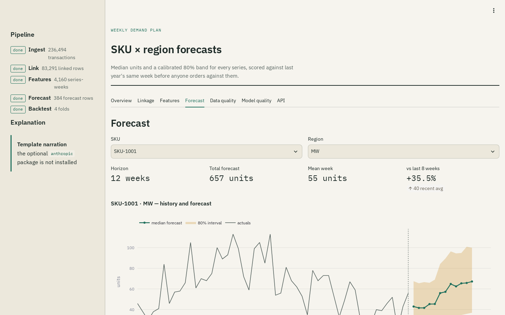
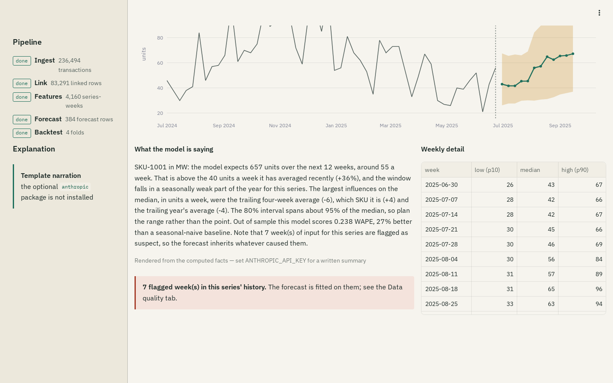
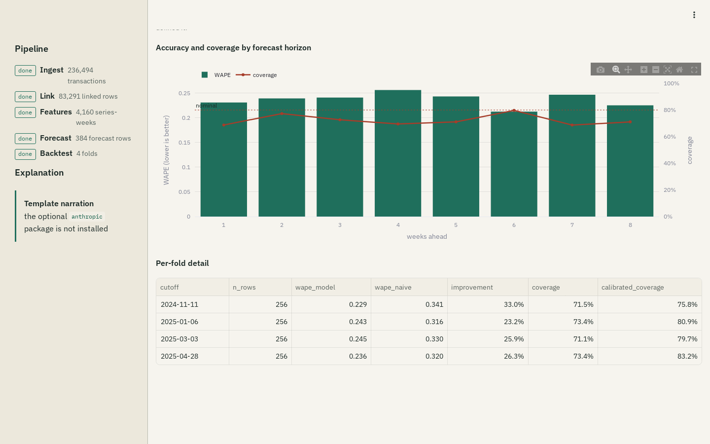
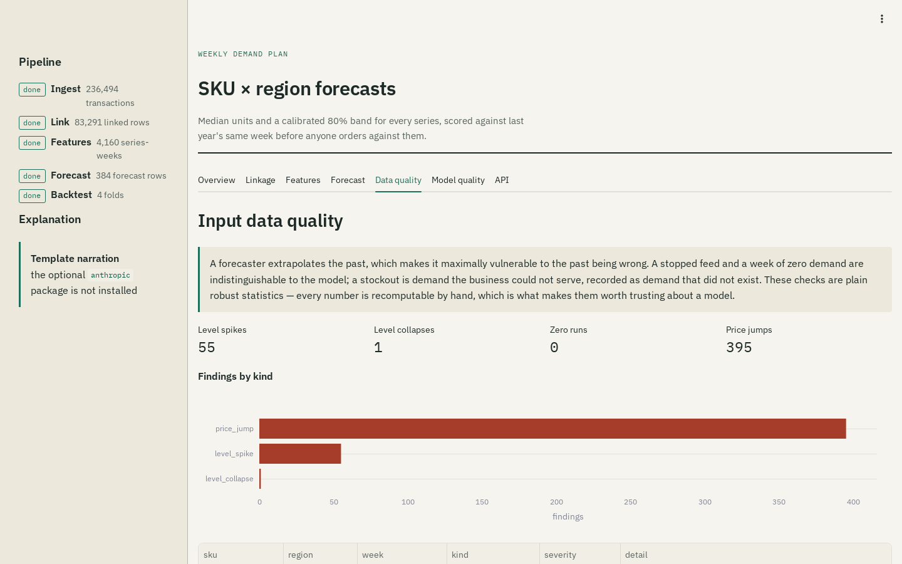
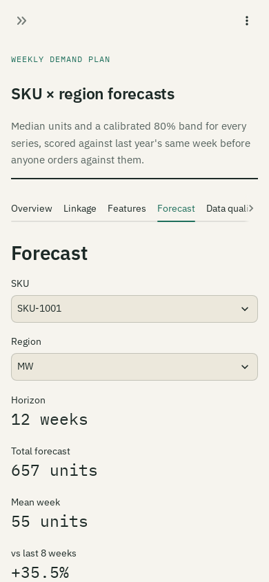
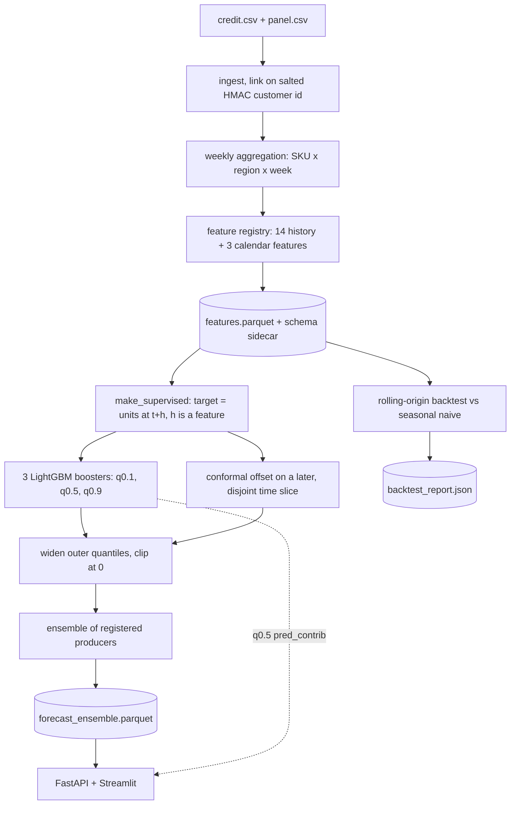
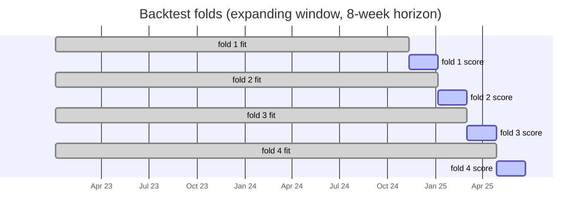

# SKU x Region Demand Forecasting

Weekly unit-demand forecasts for every SKU in every region, delivered as a calibrated 80% prediction interval
that a planner can size safety stock against. LightGBM quantile regression, conformal calibration, a rolling-origin
backtest against a seasonal-naive baseline, a FastAPI service and a Streamlit dashboard. It runs from a clean clone
with no credentials and no dataset to download: the pipeline generates its own seeded data.

## Results

Four rolling-origin folds, 8-week horizon, scored only on weeks after each fold's cutoff
(`python -m src.evaluation.backtest --folds 4 --horizon 8`, also written to `backtest_report.json`):

```
cutoff         rows     WAPE    naive    lift   cover     cal
--------------------------------------------------------------
2024-11-11      256    0.229    0.341  33.0%   71.5%   75.8%
2025-01-06      256    0.243    0.316  23.2%   73.4%   80.9%
2025-03-03      256    0.245    0.330  25.9%   71.1%   79.7%
2025-04-28      256    0.236    0.320  26.3%   73.4%   83.2%
--------------------------------------------------------------
mean                   0.238    0.327  27.2%   72.4%   79.9%
```

The median forecast has 27.2% lower WAPE than "same week last year". The raw 10th to 90th percentile band covered
the truth 72.4% of the time; after conformal calibration it covers 79.9% against a nominal 80%, out of sample.
LightGBM is not bit-identical across platforms, so expect the third decimal to drift on other hardware.



## Running it

### Docker Compose (recommended)

Needs only Docker. One command builds the image, runs the pipeline once into a named volume, then starts the API
and the dashboard against it:

```bash
docker compose up -d --wait      # or: make up
```

- Dashboard: http://localhost:8361
- API docs: http://localhost:8360/docs

`make backtest`, `make test` and `make lint` run the same commands inside the image. `docker compose down -v`
(or `make down`) stops everything and drops the data volume.

### Local Python

Python 3.13 (`.python-version`), plus OpenMP for LightGBM: `brew install libomp` on macOS, `libgomp1` on Debian.

```bash
python3.13 -m venv .venv && source .venv/bin/activate
pip install -r requirements-core.txt -r requirements-dev.txt
python -m scripts.run_pipeline --weeks 130 --horizon 12   # generate data, ingest, link, features, train, ensemble
python -m src.evaluation.backtest --folds 4 --horizon 8   # the table above
python -m pytest tests/ -q                                # 297 tests
uvicorn src.serving.app:app --port 8000                   # API
streamlit run streamlit_demo.py                           # dashboard on :8501
```

The pipeline writes 236,494 seeded transactions (8 SKUs x 4 regions x 130 weeks) and everything derived from them
into `DATA_DIR` (default `./data`) and the boosters into `MODEL_DIR` (default `./artifacts/models`); both are
git-ignored. The other settings are listed in [`.env.example`](.env.example). None is required; `HASH_SALT`, which
keys the customer-id HMAC, has a public default, so set your own for real data.

## Dashboard

Seven tabs over whatever the pipeline has produced so far: source data, panel linkage, features, the forecast with
its explanation, input data quality, measured accuracy, and a live client for the API. Every tab has an empty state
that names the command to run.



| Model quality | Data quality | Phone |
|---|---|---|
|  |  |  |

## API

| Endpoint | Returns |
|---|---|
| `POST /forecast` | `q0.1`, `q0.5`, `q0.9` per week for `{"sku", "region", "horizon_weeks"}` (1 to 52); 404 for an unknown series |
| `POST /explain` | the forecast's facts, its top drivers and a plain-language note (a template, or Claude if configured) |
| `GET /anomalies` | flagged input weeks with a summary by kind; filter with `sku`, `region`, `limit` |
| `GET /models` | registered forecasters, orphan forecast files on disk, and whether AI narration is available |
| `GET /health` | `{"status": "ok"}` |

Captured from the Compose stack (`:8360`) after a fresh pipeline run:

```bash
curl -s -X POST localhost:8360/forecast -H 'Content-Type: application/json' \
  -d '{"sku": "SKU-1001", "region": "MW", "horizon_weeks": 2}'
```

```json
[
  {"sku": "SKU-1001", "region": "MW", "date": "2025-06-30",
   "q0.1": 26.22324233347089, "q0.5": 43.07086187870178, "q0.9": 67.48251156044091},
  {"sku": "SKU-1001", "region": "MW", "date": "2025-07-07",
   "q0.1": 27.626412708413127, "q0.5": 41.68293922678416, "q0.9": 65.5213422465664}
]
```

```bash
curl -s -X POST localhost:8360/explain -H 'Content-Type: application/json' \
  -d '{"sku": "SKU-1001", "region": "MW", "horizon_weeks": 8}'
```

```json
{
  "sku": "SKU-1001",
  "region": "MW",
  "explanation": "SKU-1001 in MW: the model expects 396 units over the next 8 weeks, around 49 a week. That is above the 40 units a week it has averaged recently (+22%), and the window falls in a seasonally weak part of the year for this series. The largest influences on the median, in units a week, were the trailing four-week average (-6), the trailing year's average (-4) and which SKU it is (+3). The 80% interval spans about 95% of the median, so plan the range rather than the point. Out of sample this model scores 0.238 WAPE, 27% better than a seasonal-naive baseline. Note that 7 week(s) of input for this series are flagged as suspect, so the forecast inherits whatever caused them.",
  "source": "template",
  "model": null,
  "facts": {
    "total_forecast": 395.6,
    "mean_weekly": 49.4,
    "recent_mean_weekly": 40.4,
    "change_vs_recent": 0.225,
    "interval_width_pct": 0.947,
    "drivers": [
      {"feature": "roll_4w_mean", "contribution": -6.24, "description": "the trailing four-week average"},
      {"feature": "roll_52w_mean", "contribution": -4.33, "description": "the trailing year's average"},
      {"feature": "sku", "contribution": 2.66, "description": "which SKU it is"}
    ],
    "anomaly_count": 7,
    "...": "trimmed: the remaining facts fields"
  }
}
```

```bash
curl -s -X POST localhost:8360/forecast -H 'Content-Type: application/json' \
  -d '{"sku": "SKU-999", "region": "MW", "horizon_weeks": 3}'
# 404 {"detail":"No forecast found for sku='SKU-999' and region='MW'."}
```

## Architecture



Each fold refits the boosters and the conformal offset on everything up to its cutoff, then scores the next 8 weeks:



## Design decisions

**Features cannot see the current week.** Features are declared in `src/features/registry.py` against a `History`
object that only exposes the target and price already shifted one week. `History.lag(0)` raises, and nothing returns
the row's own week, so a leaking rolling mean is not something a new feature can express. Calendar features (week of
year, month, year) live in a separate, explicit list. The leakage tests enumerate the registry, so a feature added
later is covered automatically. Shifting the lag by one more step makes 10 tests fail. The cost is a small DSL to learn.

**Direct multi-horizon, one model per quantile.** Each training row is (origin week, horizon h, target at t+h), with
h as a feature, so a single booster per quantile covers all 12 horizons without feeding predictions back in. I chose
this over a recursive model so errors do not compound and intervals stay meaningful at long horizons. The price is a
training set 12 times the size of the feature table (47,424 rows).

**Conformal calibration on a time split.** Pinball loss says nothing about how often the truth lands in the band.
`src/evaluation/conformal.py` implements conformalised quantile regression (Romano, Patterson and Candès, 2019):
score each calibration row by how far it fell outside the band, take the `(1-α)(1 + 1/n)` quantile, widen both ends.
The calibration slice is later in time than the fit slice; a random split would put a week's neighbours on both
sides. Time series are not exchangeable, so the coverage guarantee is not assumed; it is measured in the backtest.

**Only registered models get blended.** `src/models/registry.py` lists the forecasters this code implements. A
`forecast_*.parquet` with no registered producer is logged as an orphan, shown at `GET /models` and in the dashboard,
and left out of the ensemble (`--include-unregistered` overrides). The DeepAR and PyMC trainers are stubs and are
not registered. Feature tables carry a `.schema.json` sidecar, and loading refuses a table whose columns disagree
with the compiled-in registry.

**A cached, indexed forecast store.** `src/serving/store.py` loads the forecast parquet once, indexes it by
`(sku, region)` and invalidates on the file's `(mtime_ns, size)`, so a fresh pipeline run is served on the next
request without a restart. `python -m scripts.benchmark --only serving` at 25,000 series x 12 weeks measures about
15 ms per request reading parquet each time against about 40 µs warm, with a one-off index build of about 1 s.

**Explanations are arithmetic first, prose second.** `src/explain/facts.py` computes every number `/explain` states.
The drivers come from the saved median booster's own `pred_contrib` (exact tree SHAP values) on the rows the forecast
was made from, averaged over its weeks, so each one reads as units a week added or removed. A language model, when
`anthropic` and `ANTHROPIC_API_KEY` are present, only rephrases that JSON; without them, or on any failure, the same
facts are rendered from a template and the endpoint still returns 200.

**Input checks are plain robust statistics.** `src/quality/anomalies.py` flags level spikes and collapses (modified
z-scores on median and MAD), runs of zero weeks and week-on-week price moves of 25% or more. On the generated data it
flags 451 weeks: 395 price moves (the planted promotions starting and ending), 55 spikes and 1 collapse.

## Testing

297 tests, under five seconds, no network and no credentials. They cover leakage across series and filled gaps,
disjoint fit and predict panels at each backtest cutoff, SHAP drivers that sum to the prediction, cache
invalidation, seasonality that must not be flagged as an anomaly, a forecast window that crosses New Year, and that
`DATA_DIR` can never overlap the committed `examples/sample_data/`. Lint is `ruff check` and `ruff format --check`.

## Limitations and roadmap

- **Synthetic data** with planted seasonality, trend, promotions and noise. Next: a public retail dataset with
  stockouts and substitution.
- **One model.** The ensemble seam is tested, but only LightGBM is implemented; DeepAR and PyMC are stubs.
- **No hierarchical reconciliation** yet: regional forecasts do not sum to a national total.
- **Promotions are inferred from price.** A promo calendar would help accuracy and the anomaly checks.
- **Per-process forecast cache**; past a few hundred MB per worker, move to a columnar store with pushdown.
- **The Airflow DAG** (`dags/forecast_dag.py`) is included but not exercised by the tests.

## License

MIT, see [LICENSE](LICENSE).
